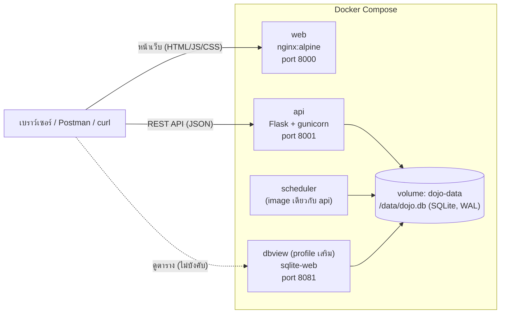

# สถาปัตยกรรมของระบบ

## 1. ภาพรวม

DojoMart เป็นระบบร้านค้าออนไลน์ขนาดเล็กสำหรับการฝึกทดสอบซอฟต์แวร์ ประกอบด้วยส่วนหน้าเว็บ (front-end) ส่วนบริการ API (back-end) ส่วนงานตั้งเวลา และฐานข้อมูล ทั้งหมดทำงานในคอนเทนเนอร์บนเครื่องของผู้ทดสอบเอง และออกแบบให้ใช้ทรัพยากรน้อย (หน่วยความจำรวมประมาณ 100 MB)



## 2. คอนเทนเนอร์

| บริการ | ภาพ (image) | พอร์ตบนเครื่อง | หน้าที่ |
|---|---|---|---|
| `web` | `nginx:alpine` | `WEB_PORT` (ค่าเริ่มต้น 8000) | เสิร์ฟไฟล์ static ของหน้าเว็บ ไม่มี business logic และสร้างไฟล์ `config.js` (ที่อยู่ API) ตอนเริ่มทำงาน |
| `api` | สร้างจาก `app/Dockerfile` (Python 3.12) | `API_PORT` (ค่าเริ่มต้น 8001) | REST API, business logic, การเข้าถึงฐานข้อมูล, สร้างฐานข้อมูลและข้อมูลเริ่มต้นเมื่อเริ่มครั้งแรก |
| `scheduler` | ภาพเดียวกับ `api` คำสั่งต่างกัน | ไม่เปิดพอร์ต | รันงานตั้งเวลาทุกต้นชั่วโมง (ดู `jobs.md`) |
| `dbview` | สร้างจาก `app/dbview/Dockerfile` (ติดตั้ง `sqlite-web` บน Python 3.12) | `DBVIEW_PORT` (ค่าเริ่มต้น 8081) | ดูตารางในฐานข้อมูลผ่านเว็บ ทำงานเมื่อเปิดด้วย profile `dbview` เท่านั้น เปิดแบบอ่านอย่างเดียว สร้างจากซอร์สแทนการดึงภาพสำเร็จรูป เพื่อให้ได้ไบนารีของสถาปัตยกรรมเครื่องจริง (native) บนทุกแพลตฟอร์ม ไม่ต้องอาศัยการจำลอง (emulation) |

- ทุกพอร์ตผูกกับ `127.0.0.1` ของเครื่องผู้ทดสอบเท่านั้น
- เขตเวลาของทุกคอนเทนเนอร์ตั้งเป็น `Asia/Bangkok` (`TZ`)
- ฐานข้อมูลอยู่ใน volume ชื่อ `dojo-data` ที่ path `/data/dojo.db` และคงอยู่เมื่อหยุดหรือเริ่มคอนเทนเนอร์ใหม่ จะถูกล้างเมื่อสั่ง `docker compose down -v` หรือเรียก `POST /api/reset`

## 3. เทคโนโลยี

| ชั้น | เทคโนโลยี |
|---|---|
| Back-end | Python 3.12, Flask, gunicorn (แบบ threads), โมดูล `sqlite3` มาตรฐาน |
| ฐานข้อมูล | SQLite เปิดโหมด WAL, `PRAGMA foreign_keys = ON`, `busy_timeout` 5000 มิลลิวินาที |
| Front-end | HTML, CSS, JavaScript (vanilla) ไม่มีขั้นตอน build เรียก API ด้วย `fetch` |
| งานตั้งเวลา | โปรเซส Python วนรอจนถึงต้นชั่วโมงแล้วเรียกงานตามลำดับ |

## 4. การสื่อสารและการยืนยันตัวตน

- หน้าเว็บอ่านที่อยู่ API จากไฟล์ `/config.js` (`window.DOJO_CONFIG = { apiBaseUrl: "http://localhost:<API_PORT>" }`) ที่ container `web` สร้างจากตัวแปร `API_PORT`
- API อนุญาตทุก origin (CORS เปิดกว้าง) การยืนยันตัวตนใช้ส่วนหัว `Authorization: Bearer <token>` ไม่ใช้ cookie
- หน้าเว็บเก็บโทเคนใน `localStorage` ภายใต้คีย์ `dojo_token` และล้างเมื่อออกจากระบบหรือเมื่อ API ตอบ 401
- ฐานข้อมูลเก็บโทเคนเป็นค่าแฮช (SHA-256) ไม่เก็บโทเคนตรง

## 5. หลักการออกแบบที่สำคัญ

1. **ชั้นข้อมูลเดียว:** `api` และ `scheduler` ใช้โค้ดชั้น business logic ร่วมกัน (เช่น ฟังก์ชันยกเลิกคำสั่งซื้อ) เพื่อให้ผลของการยกเลิกโดยผู้ใช้และโดยงานตั้งเวลาเหมือนกัน
2. **จำนวนเงินเป็นสตางค์:** ฐานข้อมูลเก็บจำนวนเงินเป็นจำนวนเต็มหน่วยสตางค์ การคำนวณใช้เลขจำนวนเต็มหรือ `decimal` ไม่ใช้ `float` และแปลงเป็นสตริง 2 ตำแหน่งเมื่อส่งออก
3. **เวลาเก็บเป็น UTC:** ฐานข้อมูลเก็บเวลาเป็น ISO 8601 UTC (`...Z`) และ API แปลงเป็น `+07:00` ก่อนส่งออก การกำหนดวันและชั่วโมงใช้เขตเวลา Asia/Bangkok
4. **ความถูกต้องภายใต้การทำงานพร้อมกัน:** การลดสต็อกใช้คำสั่งปรับค่าแบบมีเงื่อนไข (`UPDATE ... SET stock = stock - :q WHERE id = :id AND stock >= :q`) ภายในธุรกรรมเดียวกับการสร้างคำสั่งซื้อ การนับสิทธิ์คูปองและการสร้างคำสั่งซื้อทำในธุรกรรมแบบ `BEGIN IMMEDIATE` เพื่อให้ตรวจสอบและบันทึกต่อเนื่องกัน ความไม่ซ้ำของชื่อผู้ใช้ รหัสสินค้า รหัสคูปอง และรีวิว บังคับด้วย unique index
5. **ลำดับการตรวจสอบคำขอ:** เป็นไปตาม `REQ-COM-007`
6. **ข้อผิดพลาด:** ทุกข้อผิดพลาดตอบในรูปแบบเดียวกันตาม `api.md`

## 6. จุดเชื่อมต่อสำหรับการฝึก (อยู่นอกขอบเขตการทดสอบ)

| Endpoint | หน้าที่ |
|---|---|
| `GET /api/health` | ตรวจสอบว่า API พร้อม ตอบ `{ "status": "ok" }` |
| `GET /api/version` | ตอบ `version`, `source_hash` (ค่าแฮชของซอร์สโค้ดที่คำนวณตอน build), `started_at` |
| `POST /api/reset` | ล้างข้อมูลและโหลดข้อมูลเริ่มต้นใหม่ ตอบ `{ "status": "reset", "reset_at": "<เวลา>" }` ไม่ต้องยืนยันตัวตน |

หน้าเว็บแสดง `DojoMart v<version> (<source_hash 8 ตัวแรก>)` ที่ส่วนท้ายของทุกหน้า

## 7. โครงสร้างโฟลเดอร์ของ repository

```
test-dojo/
├── README.md
├── docker-compose.yml
├── .env.example
├── app/                  ซอร์สโค้ดของ api, scheduler และ front-end
├── docs/
│   ├── requirements/     ข้อกำหนด (PRD)
│   ├── design/           เอกสารออกแบบ (ไฟล์นี้)
│   ├── instructions/     คำแนะนำการใช้งานและบัญชีทดสอบ
│   └── traceability.md
└── exercises/            แบบฟอร์มสำหรับผู้ทดสอบ
```
