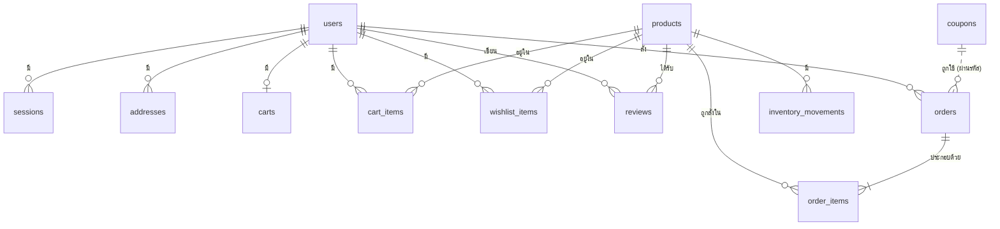

# โมเดลข้อมูล

## 1. ข้อตกลงทั่วไป

| เรื่อง | ข้อตกลง |
|---|---|
| ฐานข้อมูล | SQLite เปิด `PRAGMA foreign_keys = ON` |
| จำนวนเงิน | คอลัมน์ชื่อลงท้าย `_satang` เป็น `INTEGER` หน่วยสตางค์ (100 สตางค์ = 1 บาท) |
| เวลา | `TEXT` ในรูป ISO 8601 UTC ละเอียดระดับวินาที เช่น `2026-10-10T07:30:05Z` ยกเว้นเวลาของคูปอง (`starts_at`, `expires_at`) ที่ละเอียดระดับนาที เช่น `2026-10-10T07:30Z` |
| วันที่ล้วน | `TEXT` รูปแบบ `YYYY-MM-DD` |
| ค่าจริง/เท็จ | `INTEGER` ค่า 0 หรือ 1 |
| ชื่อผู้ใช้ | จัดเก็บตามตัวพิมพ์ที่ผู้ใช้ป้อน ความไม่ซ้ำไม่แยกตัวพิมพ์ |

## 2. แผนภาพความสัมพันธ์

## 3. ตารางและข้อจำกัด

### `users`

| คอลัมน์ | ชนิด | ข้อจำกัด |
|---|---|---|
| `id` | INTEGER | PRIMARY KEY |
| `username` | TEXT | NOT NULL, ยาว 4–20 อักขระ |
| `password_hash` | TEXT | NOT NULL (แฮชแบบเติม salt) |
| `display_name` | TEXT | NOT NULL, ยาว 2–50 อักขระ |
| `role` | TEXT | NOT NULL, CHECK `IN ('customer','staff','manager','admin')` |
| `phone` | TEXT | NULL |
| `birthdate` | TEXT | NULL (มีค่าสำหรับ `customer`) |
| `status` | TEXT | NOT NULL DEFAULT `'ACTIVE'`, CHECK `IN ('ACTIVE','LOCKED')` |
| `failed_login_count` | INTEGER | NOT NULL DEFAULT 0, CHECK `>= 0` |
| `locked_until` | TEXT | NULL (เวลาสิ้นสุดการล็อกชั่วคราว) |
| `must_change_password` | INTEGER | NOT NULL DEFAULT 0, CHECK `IN (0,1)` |
| `created_at` | TEXT | NOT NULL |

ดัชนี: `UNIQUE INDEX ux_users_username_ci ON users (lower(username))`

### `sessions`

| คอลัมน์ | ชนิด | ข้อจำกัด |
|---|---|---|
| `token_hash` | TEXT | PRIMARY KEY (SHA-256 ของโทเคน) |
| `user_id` | INTEGER | NOT NULL, FOREIGN KEY → `users(id)` ON DELETE CASCADE |
| `created_at` | TEXT | NOT NULL |
| `expires_at` | TEXT | NOT NULL (`created_at` บวก 600 วินาที) |

### `addresses`

| คอลัมน์ | ชนิด | ข้อจำกัด |
|---|---|---|
| `id` | INTEGER | PRIMARY KEY |
| `user_id` | INTEGER | NOT NULL, FOREIGN KEY → `users(id)` ON DELETE CASCADE |
| `label` | TEXT | NOT NULL, ยาว 1–30 |
| `recipient_name` | TEXT | NOT NULL, ยาว 2–50 |
| `phone` | TEXT | NOT NULL, 10 หลักตัวเลข ขึ้นต้นด้วย 0 |
| `line1` | TEXT | NOT NULL, ยาว 5–100 |
| `line2` | TEXT | NULL, ยาวไม่เกิน 100 |
| `province` | TEXT | NOT NULL, ยาว 2–50 |
| `postal_code` | TEXT | NOT NULL, 5 หลักตัวเลข |
| `is_default` | INTEGER | NOT NULL DEFAULT 0, CHECK `IN (0,1)` |
| `created_at` | TEXT | NOT NULL |

ดัชนี: `UNIQUE INDEX ux_addresses_default ON addresses (user_id) WHERE is_default = 1` (ผู้ใช้หนึ่งคนมีที่อยู่หลักได้ไม่เกินหนึ่งรายการ)

### `products`

| คอลัมน์ | ชนิด | ข้อจำกัด |
|---|---|---|
| `id` | INTEGER | PRIMARY KEY |
| `sku` | TEXT | NOT NULL UNIQUE, ตรงรูปแบบ `^[A-Z0-9-]{3,20}$` |
| `name` | TEXT | NOT NULL, ยาว 2–100 |
| `description` | TEXT | NULL, ยาวไม่เกิน 1000 |
| `category` | TEXT | NOT NULL, CHECK `IN ('Drinkware','Apparel','Stationery','Electronics','Home')` |
| `price_satang` | INTEGER | NOT NULL, CHECK `price_satang > 0 AND price_satang <= 9999999` |
| `stock` | INTEGER | NOT NULL, CHECK `stock >= 0` |
| `active` | INTEGER | NOT NULL DEFAULT 1, CHECK `IN (0,1)` |
| `created_at` | TEXT | NOT NULL |

### `inventory_movements`

| คอลัมน์ | ชนิด | ข้อจำกัด |
|---|---|---|
| `id` | INTEGER | PRIMARY KEY |
| `product_id` | INTEGER | NOT NULL, FOREIGN KEY → `products(id)` |
| `delta` | INTEGER | NOT NULL, CHECK `delta <> 0` |
| `stock_after` | INTEGER | NOT NULL, CHECK `stock_after >= 0` |
| `reason` | TEXT | NOT NULL, CHECK `IN ('RECEIVE','DAMAGE','CORRECTION','ORDER','CANCEL','RETURN')` |
| `actor` | TEXT | NOT NULL (ชื่อผู้ใช้ หรือ `system`) |
| `created_at` | TEXT | NOT NULL |

### `carts`

| คอลัมน์ | ชนิด | ข้อจำกัด |
|---|---|---|
| `user_id` | INTEGER | PRIMARY KEY, FOREIGN KEY → `users(id)` ON DELETE CASCADE |
| `coupon_code` | TEXT | NULL (รหัสคูปองตัวพิมพ์ใหญ่) |
| `updated_at` | TEXT | NOT NULL |

### `cart_items`

| คอลัมน์ | ชนิด | ข้อจำกัด |
|---|---|---|
| `id` | INTEGER | PRIMARY KEY |
| `user_id` | INTEGER | NOT NULL, FOREIGN KEY → `users(id)` ON DELETE CASCADE |
| `product_id` | INTEGER | NOT NULL, FOREIGN KEY → `products(id)` |
| `quantity` | INTEGER | NOT NULL, CHECK `quantity BETWEEN 1 AND 10` |
| `created_at` | TEXT | NOT NULL |

ข้อจำกัด: `UNIQUE (user_id, product_id)`

### `wishlist_items`

| คอลัมน์ | ชนิด | ข้อจำกัด |
|---|---|---|
| `user_id` | INTEGER | NOT NULL, FOREIGN KEY → `users(id)` ON DELETE CASCADE |
| `product_id` | INTEGER | NOT NULL, FOREIGN KEY → `products(id)` |
| `added_at` | TEXT | NOT NULL |

ข้อจำกัด: `PRIMARY KEY (user_id, product_id)`

### `reviews`

| คอลัมน์ | ชนิด | ข้อจำกัด |
|---|---|---|
| `id` | INTEGER | PRIMARY KEY |
| `product_id` | INTEGER | NOT NULL, FOREIGN KEY → `products(id)` |
| `user_id` | INTEGER | NOT NULL, FOREIGN KEY → `users(id)` ON DELETE CASCADE |
| `rating` | INTEGER | NOT NULL, CHECK `rating BETWEEN 1 AND 5` |
| `comment` | TEXT | NULL, CHECK `comment IS NULL OR length(comment) <= 500` |
| `created_at` | TEXT | NOT NULL |

ข้อจำกัด: `UNIQUE (product_id, user_id)`

### `coupons`

| คอลัมน์ | ชนิด | ข้อจำกัด |
|---|---|---|
| `id` | INTEGER | PRIMARY KEY |
| `code` | TEXT | NOT NULL UNIQUE, ตัวพิมพ์ใหญ่ ตรงรูปแบบ `^[A-Z0-9]{4,20}$` |
| `type` | TEXT | NOT NULL, CHECK `IN ('PERCENT','FIXED')` |
| `percent_off` | INTEGER | NULL, CHECK `percent_off BETWEEN 1 AND 100` |
| `amount_off_satang` | INTEGER | NULL, CHECK `amount_off_satang > 0` |
| `max_discount_satang` | INTEGER | NULL, CHECK `max_discount_satang > 0` |
| `min_spend_satang` | INTEGER | NOT NULL DEFAULT 0, CHECK `min_spend_satang >= 0` |
| `starts_at` | TEXT | NOT NULL (ระดับนาที, UTC) |
| `expires_at` | TEXT | NOT NULL (ระดับนาที, UTC) |
| `per_user_limit` | INTEGER | NOT NULL DEFAULT 1, CHECK `per_user_limit BETWEEN 1 AND 99` |
| `total_limit` | INTEGER | NULL, CHECK `total_limit >= 1` |
| `active` | INTEGER | NOT NULL DEFAULT 1, CHECK `IN (0,1)` |
| `created_at` | TEXT | NOT NULL |

ข้อจำกัดระดับตาราง
- `CHECK (starts_at <= expires_at)`
- `CHECK ((type = 'PERCENT' AND percent_off IS NOT NULL AND amount_off_satang IS NULL) OR (type = 'FIXED' AND amount_off_satang IS NOT NULL AND percent_off IS NULL))`

### `orders`

| คอลัมน์ | ชนิด | ข้อจำกัด |
|---|---|---|
| `id` | INTEGER | PRIMARY KEY |
| `user_id` | INTEGER | NOT NULL, FOREIGN KEY → `users(id)` |
| `status` | TEXT | NOT NULL, CHECK `IN ('PENDING_PAYMENT','PAID','PACKED','SHIPPED','DELIVERED','CANCELLED','RETURNED')` |
| `coupon_code` | TEXT | NULL |
| `subtotal_satang` | INTEGER | NOT NULL, CHECK `>= 0` |
| `volume_discount_satang` | INTEGER | NOT NULL, CHECK `>= 0` |
| `coupon_discount_satang` | INTEGER | NOT NULL, CHECK `>= 0` |
| `goods_total_satang` | INTEGER | NOT NULL, CHECK `>= 0` |
| `vat_satang` | INTEGER | NOT NULL, CHECK `>= 0` |
| `shipping_satang` | INTEGER | NOT NULL, CHECK `>= 0` |
| `grand_total_satang` | INTEGER | NOT NULL, CHECK `>= 0` |
| `addr_label`, `addr_recipient_name`, `addr_phone`, `addr_line1`, `addr_line2`, `addr_province`, `addr_postal_code` | TEXT | สำเนาที่อยู่จัดส่ง (`addr_line2` เป็น NULL ได้ นอกนั้น NOT NULL) |
| `refund_amount_satang` | INTEGER | NOT NULL DEFAULT 0, CHECK `>= 0` |
| `created_at` | TEXT | NOT NULL |
| `paid_at`, `packed_at`, `shipped_at`, `delivered_at`, `cancelled_at`, `returned_at` | TEXT | NULL |

ข้อจำกัดระดับตาราง
- `CHECK (goods_total_satang = subtotal_satang - volume_discount_satang - coupon_discount_satang)`
- `CHECK (grand_total_satang = goods_total_satang + vat_satang + shipping_satang)`

### `order_items`

| คอลัมน์ | ชนิด | ข้อจำกัด |
|---|---|---|
| `id` | INTEGER | PRIMARY KEY |
| `order_id` | INTEGER | NOT NULL, FOREIGN KEY → `orders(id)` ON DELETE CASCADE |
| `product_id` | INTEGER | NOT NULL, FOREIGN KEY → `products(id)` |
| `sku` | TEXT | NOT NULL (สำเนา ณ เวลาสั่ง) |
| `name` | TEXT | NOT NULL (สำเนา ณ เวลาสั่ง) |
| `unit_price_satang` | INTEGER | NOT NULL, CHECK `> 0` |
| `quantity` | INTEGER | NOT NULL, CHECK `quantity BETWEEN 1 AND 10` |
| `line_total_satang` | INTEGER | NOT NULL, CHECK `line_total_satang = unit_price_satang * quantity` |

### `job_runs`

| คอลัมน์ | ชนิด | ข้อจำกัด |
|---|---|---|
| `id` | INTEGER | PRIMARY KEY |
| `job` | TEXT | NOT NULL, CHECK `IN ('cancel-unpaid-orders','hourly-sales-report','low-stock-snapshot')` |
| `trigger` | TEXT | NOT NULL, CHECK `IN ('SCHEDULED','MANUAL')` |
| `triggered_by` | TEXT | NOT NULL (`system` หรือชื่อผู้ใช้) |
| `status` | TEXT | NOT NULL, CHECK `IN ('RUNNING','SUCCESS','FAILED')` |
| `started_at` | TEXT | NOT NULL |
| `finished_at` | TEXT | NULL |
| `summary_json` | TEXT | NULL |
| `error_message` | TEXT | NULL |

ดัชนี: `UNIQUE INDEX ux_job_runs_running ON job_runs (job) WHERE status = 'RUNNING'` (แต่ละงานมีสถานะ `RUNNING` ได้ไม่เกินหนึ่งรายการ)

### `window_reports`

| คอลัมน์ | ชนิด | ข้อจำกัด |
|---|---|---|
| `id` | INTEGER | PRIMARY KEY |
| `window_start` | TEXT | NOT NULL (ระดับนาที, UTC) |
| `window_end` | TEXT | NOT NULL (ระดับนาที, UTC) |
| `order_count` | INTEGER | NOT NULL, CHECK `>= 0` |
| `gross_sales_satang` | INTEGER | NOT NULL, CHECK `>= 0` |
| `vat_total_satang` | INTEGER | NOT NULL, CHECK `>= 0` |
| `shipping_total_satang` | INTEGER | NOT NULL, CHECK `>= 0` |
| `discount_total_satang` | INTEGER | NOT NULL, CHECK `>= 0` |
| `generated_at` | TEXT | NOT NULL |

ข้อจำกัด: `UNIQUE (window_start, window_end)`, `CHECK (window_start < window_end)`

### `low_stock_snapshot`

| คอลัมน์ | ชนิด | ข้อจำกัด |
|---|---|---|
| `position` | INTEGER | PRIMARY KEY (ลำดับในรายการ เริ่มที่ 1) |
| `product_id` | INTEGER | NOT NULL |
| `sku` | TEXT | NOT NULL |
| `name` | TEXT | NOT NULL |
| `stock` | INTEGER | NOT NULL, CHECK `>= 0` |

### `system_state`

| คอลัมน์ | ชนิด | ข้อจำกัด |
|---|---|---|
| `key` | TEXT | PRIMARY KEY |
| `value` | TEXT | NOT NULL |

ใช้เก็บ `last_reset_at` (เวลา reset ล่าสุด) และ `low_stock_taken_at` (เวลาที่บันทึก snapshot)

## 4. ข้อกำหนดเพิ่มเติม

1. การลบแถวใน `users` ไม่อยู่ในขอบเขตของระบบ คอลัมน์ ON DELETE CASCADE มีไว้เพื่อความสมบูรณ์ของโครงสร้างเท่านั้น
2. การยกเลิกคำสั่งซื้อ การคืนสินค้า และงานตั้งเวลา ปรับค่าของ `products.stock` และเพิ่มแถวใน `inventory_movements` ภายในธุรกรรมเดียวกันเสมอ
3. จำนวนครั้งที่ใช้คูปองไม่เก็บเป็นตัวนับ แต่คำนวณจาก `orders` ที่มี `coupon_code` ตรงกันและ `status <> 'CANCELLED'` ตาม `REQ-CROSS-005`
