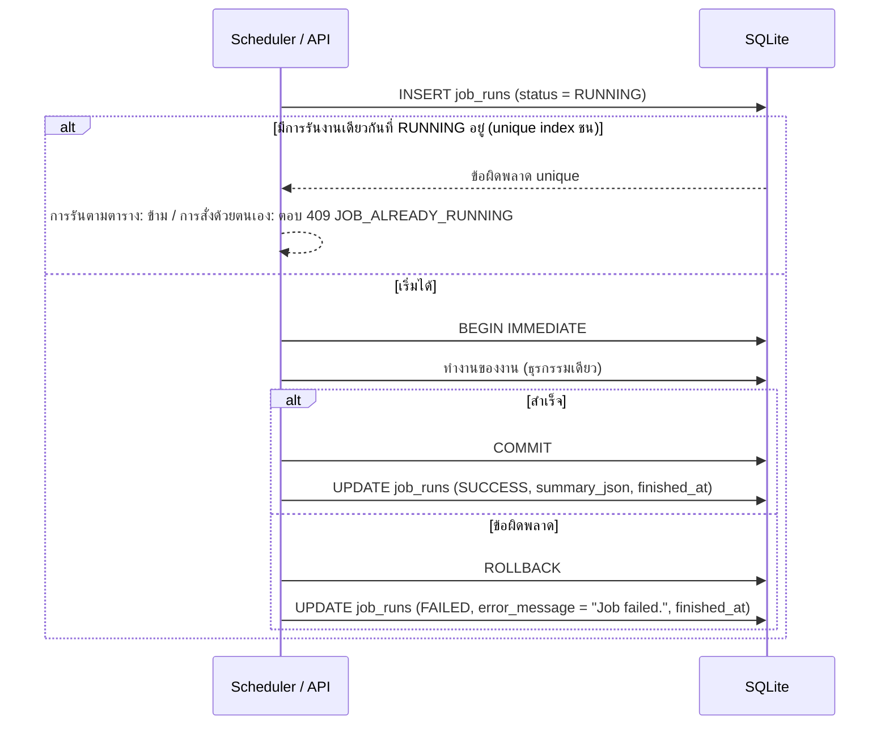

# การออกแบบงานตั้งเวลา

เอกสารนี้อธิบายการทำงานภายในของงานตั้งเวลา ส่วนกฎของแต่ละงานอยู่ใน `docs/requirements/PRD-SCHEDULE.md`

## 1. โครงสร้าง

- งานตั้งเวลาทำงานในคอนเทนเนอร์ `scheduler` ซึ่งใช้ภาพเดียวกับ `api` และรันคำสั่ง `python -m dojo.scheduler`
- ฟังก์ชันของแต่ละงานอยู่ในโมดูลที่ `api` และ `scheduler` ใช้ร่วมกัน ดังนั้นการสั่งรันด้วยตนเองผ่าน `POST /api/admin/jobs/{name}/run` ทำงานภายในโปรเซส `api` โดยเรียกฟังก์ชันเดียวกันและคืนผลเมื่อทำงานเสร็จ

## 2. วงรอบของ scheduler

1. คำนวณเวลาต้นชั่วโมงถัดไปตามเขตเวลา Asia/Bangkok
2. รอจนถึงเวลานั้น
3. เมื่อถึงเวลา เรียกงานตามลำดับ `cancel-unpaid-orders`, `hourly-sales-report`, `low-stock-snapshot` ทีละงาน
4. กลับไปข้อ 1

ระบบไม่รันย้อนหลังชั่วโมงที่พลาด (เช่น เมื่อคอนเทนเนอร์หยุดทำงาน)

## 3. การรันหนึ่งครั้ง

## 4. รายละเอียดแต่ละงาน

### cancel-unpaid-orders

1. ให้ `now` เป็นเวลาที่งานเริ่มทำงาน
2. เลือกคำสั่งซื้อที่ `status = 'PENDING_PAYMENT'` และ `created_at <= now - 60 นาที`
3. เรียงตาม `id` จากน้อยไปมาก แล้วยกเลิกทีละรายการด้วยฟังก์ชันยกเลิกคำสั่งซื้อกลางตัวเดียวกับที่ใช้ใน `POST /api/orders/{id}/cancel` โดยผู้ดำเนินการ (`actor`) ของรายการเคลื่อนไหวคือ `system`
4. `summary_json` = `{"cancelled_count": n, "order_ids": [...]}`

### hourly-sales-report

1. กำหนดช่วง `[window_start, window_end)`:
   - การรันตามตาราง: ต้นชั่วโมงของชั่วโมงก่อนหน้า ถึง ต้นชั่วโมงปัจจุบัน
   - การรันด้วยตนเองโดยไม่ระบุช่วง: เหมือนการรันตามตาราง
   - การรันด้วยตนเองที่ระบุ `from` และ `to`: ใช้ช่วงที่ระบุ
2. เลือกคำสั่งซื้อที่นับตาม `REQ-CROSS-006` และ `paid_at >= window_start` และ `paid_at < window_end`
3. รวม `order_count`, `gross_sales` (ผลรวม `grand_total`), `vat_total`, `shipping_total`, `discount_total` (ผลรวมของส่วนลดตามยอดและส่วนลดคูปอง)
4. บันทึกด้วยการ upsert บนคู่ `(window_start, window_end)` (ถ้ามีแถวอยู่แล้วให้แทนที่ค่าทั้งหมดและ `generated_at`)
5. `summary_json` = `{"window_start": "...", "window_end": "...", "order_count": n}`

### low-stock-snapshot

1. ลบข้อมูลทั้งหมดใน `low_stock_snapshot`
2. เพิ่มสินค้าที่ `active = 1` และ `stock <= 5` เรียงตามสต็อก ชื่อ (ไม่แยกตัวพิมพ์) และ `product_id` โดยกำหนด `position` ต่อเนื่องจาก 1
3. บันทึก `low_stock_taken_at` ใน `system_state` เป็นเวลาปัจจุบัน
4. `summary_json` = `{"item_count": n}`

## 5. การสร้าง snapshot เริ่มต้น

เมื่อระบบเริ่มครั้งแรกหรือหลัง `POST /api/reset` ระบบสร้างข้อมูลเริ่มต้น และบันทึก snapshot สินค้าใกล้หมดเริ่มต้นหนึ่งชุดตามกฎของ `low-stock-snapshot` โดยไม่สร้างบันทึกใน `job_runs`
