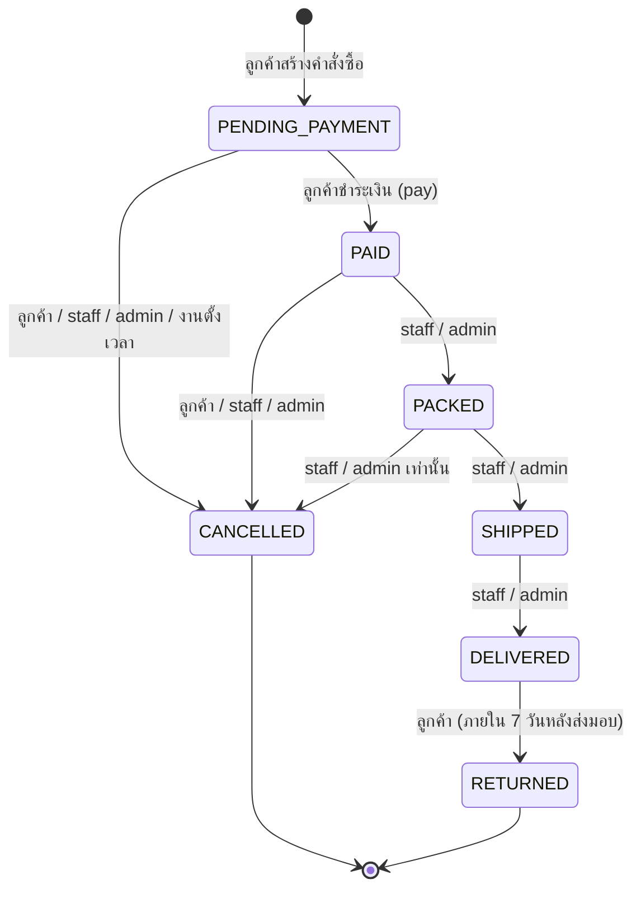
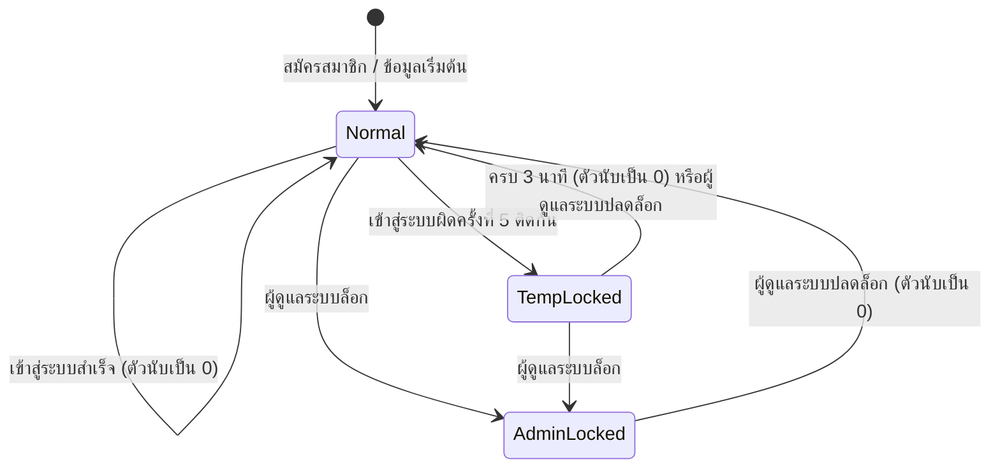
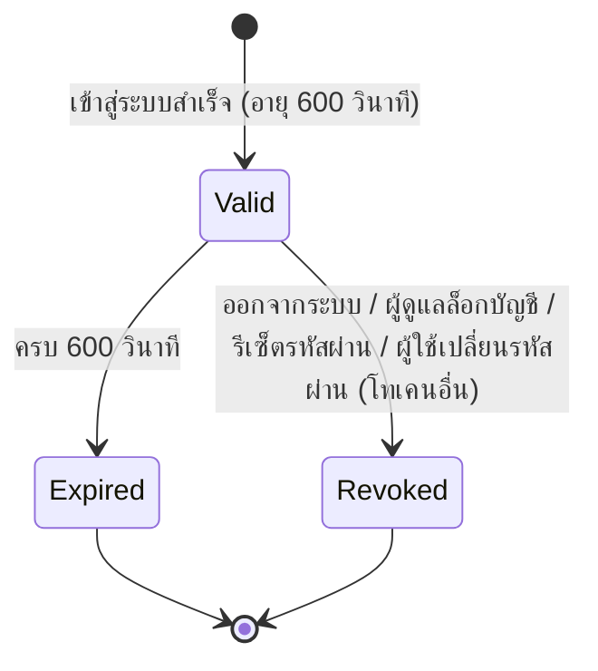
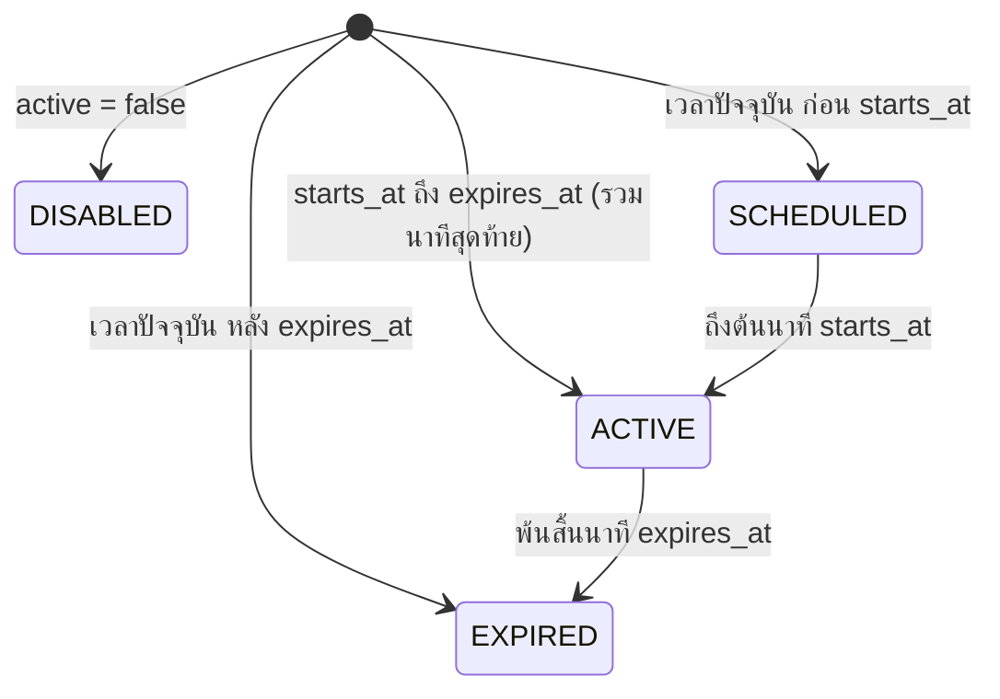
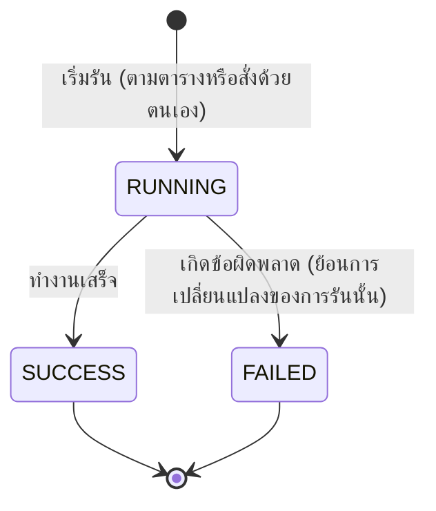

# แผนภาพสถานะ

เอกสารนี้อธิบายการเปลี่ยนสถานะของวัตถุสำคัญในระบบ ข้อกำหนดเชิงรายละเอียดอยู่ใน PRD ที่อ้างอิง หากมีข้อสงสัย ให้ถือ PRD เป็นหลัก

## 1. คำสั่งซื้อ (Order)

อ้างอิง: `REQ-ORD-004`, `REQ-ORD-005`, `REQ-ORD-006`, `REQ-SCH-002`

| จากสถานะ | ไปสถานะ | ผลข้างเคียง |
|---|---|---|
| (สร้าง) | `PENDING_PAYMENT` | ลดสต็อก (`ORDER`) ล้างตะกร้า บันทึกสำเนาข้อมูล |
| `PENDING_PAYMENT` | `PAID` | บันทึก `paid_at` |
| `PAID` | `PACKED` | บันทึก `packed_at` |
| `PACKED` | `SHIPPED` | บันทึก `shipped_at` |
| `SHIPPED` | `DELIVERED` | บันทึก `delivered_at` และ `return_deadline` มีค่า |
| `PENDING_PAYMENT`, `PAID`, `PACKED` | `CANCELLED` | คืนสต็อก (`CANCEL`) คืนสิทธิ์คูปอง บันทึก `cancelled_at` `refund_amount` เท่ากับยอดชำระสุทธิหากเคยเป็น `PAID` หรือ `PACKED` มิฉะนั้น 0.00 |
| `DELIVERED` | `RETURNED` | คืนสต็อก (`RETURN`) บันทึก `returned_at` `refund_amount` เท่ากับยอดชำระสุทธิ |

การเปลี่ยนสถานะอื่นทั้งหมดไม่อนุญาต (ตอบ 409 `INVALID_TRANSITION`)

## 2. บัญชีผู้ใช้และการเข้าสู่ระบบ

อ้างอิง: `REQ-AUTH-003` ถึง `REQ-AUTH-005`, `REQ-ADM-002`, `REQ-ADM-003`

| สถานะ | ค่าที่เก็บ | ผลต่อการเข้าสู่ระบบ |
|---|---|---|
| Normal | `status = ACTIVE`, `locked_until` ว่างหรือผ่านไปแล้ว | เข้าได้เมื่อรหัสผ่านถูกต้อง |
| TempLocked | `status = ACTIVE`, `locked_until` ยังไม่ถึง | ทุกความพยายามได้ 423 `ACCOUNT_LOCKED` |
| AdminLocked | `status = LOCKED` | รหัสผ่านถูกต้องแล้วได้ 403 `ACCOUNT_DISABLED` |

ลำดับการพิจารณาตอนเข้าสู่ระบบอยู่ใน `REQ-AUTH-003`

## 3. โทเคนเข้าสู่ระบบ (Session)

อ้างอิง: `REQ-AUTH-006`, `REQ-AUTH-007`, `REQ-CROSS-007`

## 4. สถานะของคูปอง (คำนวณจากข้อมูล)

อ้างอิง: `REQ-COUP-009`

สถานะไม่ได้เก็บไว้ในฐานข้อมูล แต่คำนวณทุกครั้งจากเวลาปัจจุบันและค่าของ `active` โดยค่า `active = false` มีลำดับก่อนสถานะอื่น

## 5. การรันงานตั้งเวลา

อ้างอิง: `REQ-SCH-006` ถึง `REQ-SCH-008`

งานเดียวกันมีสถานะ `RUNNING` ได้ครั้งละหนึ่งรายการเท่านั้น

## 6. ที่อยู่หลักของลูกค้า

อ้างอิง: `REQ-PROF-003` ถึง `REQ-PROF-005`

| เหตุการณ์ | ผล |
|---|---|
| สร้างที่อยู่รายการแรก | รายการนั้นเป็นที่อยู่หลัก |
| สร้างที่อยู่รายการต่อไป | ที่อยู่หลักเดิมไม่เปลี่ยน รายการใหม่ไม่เป็นที่อยู่หลัก |
| ตั้งรายการ X เป็นที่อยู่หลัก | X เป็นที่อยู่หลัก รายการอื่นไม่เป็นที่อยู่หลัก |
| ลบที่อยู่หลัก (ยังมีรายการเหลือ) | รายการที่สร้างเก่าที่สุดที่เหลือ (ถ้าเท่ากันใช้ `id` น้อยสุด) เป็นที่อยู่หลัก |
| ลบที่อยู่ที่ไม่ใช่ที่อยู่หลัก | ที่อยู่หลักเดิมไม่เปลี่ยน |
| ลบรายการสุดท้าย | ไม่มีที่อยู่หลัก |
